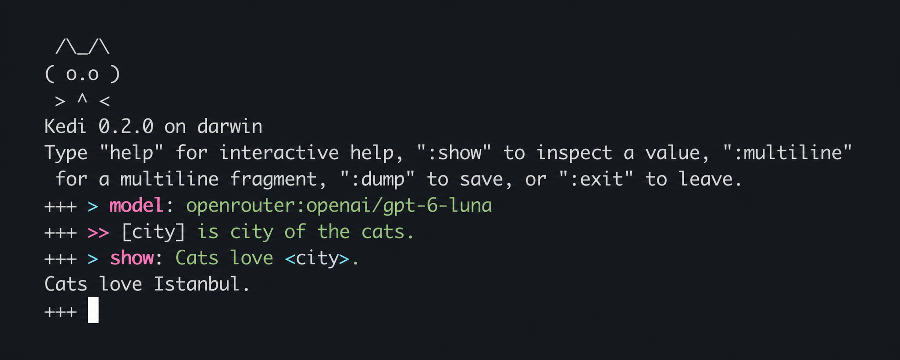
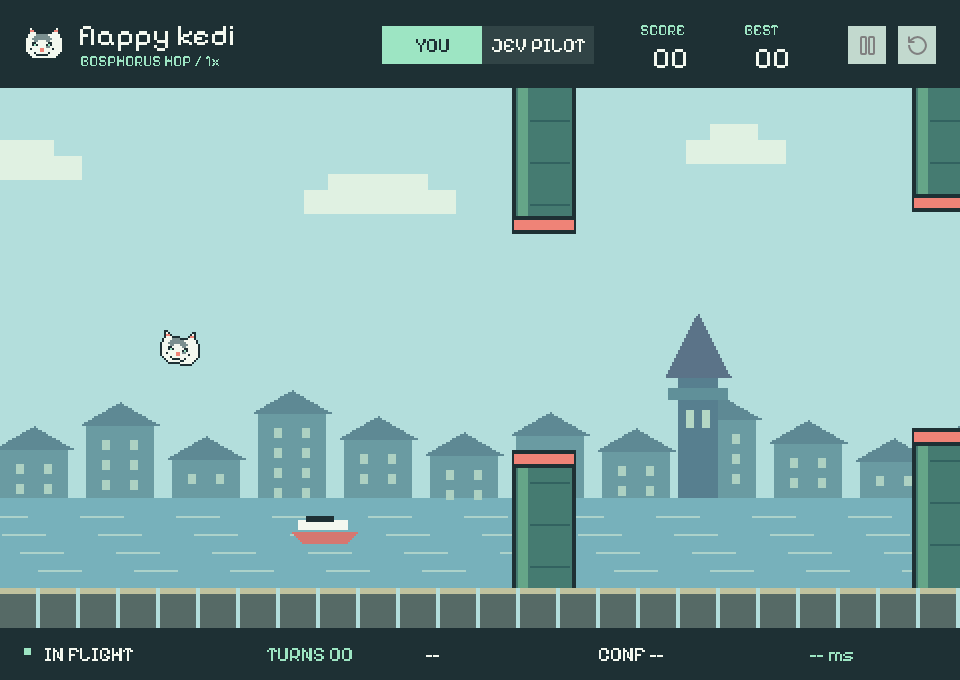

<p align="center">
  <picture>
    <source media="(prefers-color-scheme: dark)" srcset="https://raw.githubusercontent.com/kedi-lang/kedi/stable/docs/assets/brand/kedi-logo-dark.svg">
    <source media="(prefers-color-scheme: light)" srcset="https://raw.githubusercontent.com/kedi-lang/kedi/stable/docs/assets/brand/kedi-logo-light.svg">
    
  </picture>
</p>

<h1 align="center">kedi</h1>
<p align="center"><strong>Natural language, made programmable.</strong><br>
A typed orchestration language for LLM programs.</p>

<p align="center">
  <a href="https://pypi.org/project/kedi/"></a>
  <a href="https://github.com/kedi-lang/kedi/blob/stable/pyproject.toml"></a>
  <a href="https://github.com/kedi-lang/kedi/actions/workflows/tests.yml"></a>
  <a href="https://github.com/kedi-lang/kedi/blob/stable/LICENSE"></a>
</p>

<p align="center">
  <a href="https://kedi-lang.org">Website</a> &middot;
  <a href="https://docs.kedi-lang.org/">Documentation</a> &middot;
  <a href="https://github.com/kedi-lang/kedi/blob/stable/examples/README.md">Examples</a> &middot;
  <a href="https://discord.gg/cuSbZd5he">Discord</a>
</p>

In Kedi, a sentence can define a model interaction **and** the typed values it
produces. Those values become inputs to the rest of your program: another
template, a Python function, a branch, or a remote agent.

The language owns that composition. Python handles ordinary computation;
models and agent SDKs connect through the `AgentAdapter` boundary.

## A Sentence Becomes a Value

**Kedi** &middot; `main.kedi`

<!-- kedi-example: actions -->

```python
~Action(task: str, owner: str | None, deadline: str | None)

@extract_actions(notes: str) -> list[Action]:
  >> Extract agreed, unfinished work from <notes>.
  Use null for owners or deadlines that were not stated.
  The action items are [actions: list[Action]].
  = `actions`

= `extract_actions("Sam will add tests by Friday. The redesign is only a suggestion.")`
```

`<notes>` supplies the input. `[actions: list[Action]]` declares a capture.
`actions` then holds a validated list of `Action` objects, not text to parse later.
The model sees the capture **inside the sentence that gives it meaning**, alongside
the output schema. `=` returns the value from the procedure or program.

| Written once | Used throughout the program |
| --- | --- |
| A typed capture | Model-visible context, output schema, and a typed binding |
| A procedure | Reusable logic, a Python-callable function, or an agent tool |
| An agent profile | Lexically scoped model, instructions, tools, and child agents |

Type validation checks structure, not the factual truth of a model's answer.

## Try It

Install the released package:

```bash
pip install kedi
```

The examples below live in the repository. Clone it to run them against the
current source, including its parser:

```bash
git clone --recurse-submodules https://github.com/kedi-lang/kedi.git
cd kedi
uv sync --locked --dev
source .venv/bin/activate
export KEDI_ADAPTER=pydantic
export KEDI_ADAPTER_MODEL=openai:gpt-6-luna
kedi examples/meeting_actions/main.kedi
```

Set `OPENAI_API_KEY` in your environment or the checkout's `.env` before running
the final command. Never commit credentials. To try Kedi **without a model or
API key**, run `kedi examples/module_imports/main.kedi` instead.

Already using Codex? See [subscription authentication](https://github.com/kedi-lang/kedi/blob/stable/examples/README.md#setup).
On Windows, use `.venv\Scripts\Activate.ps1` and PowerShell environment syntax.
The [installation guide](https://docs.kedi-lang.org/getting-started/installation/)
covers package installs; the PyPI badge reports the published release, which may
lag the source examples.

## Program in the Terminal

**`kedi --idle` brings the language into a live session, with syntax highlighting
on by default.** Write templates, inspect typed captures, call procedures, and
mix in Python without creating a file. Bindings stay available between inputs.

<p align="center">
  
</p>

<details>
<summary>Try a template and inspect its result</summary>

<!-- kedi-repl-example -->

```console
$ kedi --idle
+++ [country] = Sweden
+++ >> The capital of <country> is [capital: str].
+++ :show <capital>
Stockholm
+++ :show `capital.upper()`
STOCKHOLM
```

</details>

Kedi and embedded Python are both highlighted as you type. Use `:multiline` to
compose a larger fragment, `:show` to inspect a value, and `:dump` to save the
session. Resume it later with `kedi --idle --load PATH`, or start with `--record`
to save on exit. No language server is needed.

Prefer plain input? Run `kedi --idle --no-color`.
[Explore the terminal REPL](https://docs.kedi-lang.org/tooling/repl/).

## Let the Program Carry the Workflow

Conditions can ask a model a question. Loops, assignments, and returns remain
ordinary program control flow. Here, only user-visible changes become release notes.

**Kedi** &middot; model-classified conditions and native loops

<!-- kedi-example: release-notes -->

```python
@release_notes(changes: list[str]) -> list[str]:
  [notes: list[str]] = `[]`

  > loop [change]: `changes`:
    > if: The text "<change>" describes a user-visible change, not internal maintenance
      >> Describe <change> without inventing new benefits.
      The one-sentence release note is [note: str].
      [notes] := `notes + [note]`

  = `notes`

= `release_notes(["CSV exports now preserve accents.", "Renamed a test fixture."])`
```

Use a Python condition such as `` > if: `count > 0`: `` for a deterministic
branch. Attach `> map:` to a loop to process each iteration's outputs as they
resolve. Independent template calls run
concurrently by default; dependent calls wait for their inputs. Calls sharing
a conversation retain their turn order.

[Control flow](https://docs.kedi-lang.org/core-language/control-flow/) &middot;
[Runnable release-notes workflow](https://github.com/kedi-lang/kedi/blob/stable/examples/release_notes/README.md)

## Give Agents a Scope, Then Compose Them

A profile is part of the program, not a global client configuration. Procedures
capture their lexical configuration. Tools and subagents are explicitly made
available to the profiles that need them.

**Kedi** &middot; one coordinator, two scoped reviewers

<!-- kedi-example: subagents -->

```python
> profile: security:
  > instructions: Look for missing authorization checks in the supplied change.

> profile: reliability:
  > instructions: Look for failure handling and cleanup problems in the supplied change.

> profile: coordinator:
  > subagent: security
  > subagent: reliability
  > max_agents: 2

> use: coordinator
[change] = A new endpoint exports every account's data and closes its connection only on success.

>> Have security and reliability review <change>, each within its own scope.
Based on both reviews, the release recommendation is [recommendation: str].
= <recommendation>
```

The template runs with `coordinator`, which receives a `delegate_task` tool for
its two declared children. Each child reviews the supplied change under its own
system instruction; the coordinator combines their findings into the typed
`recommendation`. For program-directed orchestration, use `> task` and `> await`
to start and collect child work explicitly, without a coordinator model call.

[Profiles](https://docs.kedi-lang.org/agentic-engineering/profiles/) &middot;
[Task and await](https://docs.kedi-lang.org/agentic-engineering/subagent-tasks/) &middot;
[A real procedure exposed as a tool](https://github.com/kedi-lang/kedi/blob/stable/examples/support_reply/README.md)

## Let Jev Make the Decision

Not every model interaction needs generated prose. With TypeSafe's **Jev**, Kedi
can request finite choices, boolean decisions, probabilities, and rubric scores,
then use those values in the same program.

**Kedi** &middot; route a support request with an explicit escalation criterion

<!-- kedi-example: jev -->

```python
> import: decisions
> model: typesafe/jev-latest
> settings:
  typesafe_threshold: 0.85

~Triage(
  team: Literal["billing", "access", "general"],
  urgent: Annotated[
    bool,
    "Does the request need immediate intervention?",
    `BooleanCriteria(true="Ongoing harm", false="Resolved, hypothetical, or informational")`
  ]
)

>> A customer says: "My card is still being charged every hour for the same invoice."
The routing decision for this request is [triage: Triage].

> if: `triage.urgent`:
  = Escalate to <`triage.team`>.
> else:
  = Queue for <`triage.team`>.
```

The threshold controls the boolean, not the category choice. The branch reads
the already computed value; it does not ask another model to reinterpret it.
Jev is **not** used as a free-form text generator. A generative model can draft
a reply while a separate Jev-backed procedure evaluates it, each with its own
lexical model configuration.

| Primitive | What it expresses |
| --- | --- |
| `BooleanCriteria` | Positive and negative evidence for a decision |
| `ChoiceCriteria` | The meaning of each `Literal` or enum option |
| `Probability` | A finite float constrained to `[0, 1]` |
| `Rubric` | Ordered criteria mapped to bounded numeric scores |

<details>
<summary><strong>Beyond true or false: score against an explicit rubric</strong></summary>

<!-- kedi-example: rubric -->

```python
> import: decisions
> model: typesafe/jev-latest

~Assessment(
  grounded: Annotated[Probability, "Is the reply supported by the policy?"],
  helpfulness: Annotated[
    float,
    "How useful is the next step offered to the customer?",
    `Rubric(["No next step", "Vague suggestion", "Specific, actionable next step"])`
  ]
)

>> The policy requires an order number before a delayed parcel can be investigated.
The reply says: "Please send your order number so we can investigate the delay."
The assessment of this reply against the policy is [assessment: Assessment].
= `assessment`
```

`grounded` is between 0 and 1; this three-level rubric produces a score between
0 and 2. Neither value is a proof of correctness or guaranteed calibration.

</details>

Install with `uv sync --dev --extra typesafe` and set `TYPESAFE_API_KEY`.
The source development environment includes the shared decision types.
Both Pydantic AI and LangChain integrations are supported.
`decision_info(...)` and `kedi.capture_decisions()` expose recorded evidence,
including applicable probabilities and thresholds, without another inference.
The shared primitives also support local Laya models through
[kedi-decisions](https://github.com/kedi-lang/kedi-decisions).

[Jev setup](https://github.com/kedi-lang/kedi/blob/stable/examples/jev_routing/README.md) &middot;
[Decision types](https://docs.kedi-lang.org/agent-adapters/jev-criteria/) &middot;
[Inspecting evidence](https://docs.kedi-lang.org/agent-adapters/jev-evidence/)

## Python Goes Both Ways

Import Python libraries inside Kedi, or expose a Kedi template as a typed Python
function. You do not need to move your application into a new language all at once.

```python
import kedi


@kedi.query
def draft_notice(update: str) -> str:
    """kedi
    >> Summarize the confirmed facts in <update> without inventing a recovery time.
    The customer-facing notice is [notice: str].
    = `notice`
    """
    ...


notice = draft_notice("Checkout is timing out; recovery has not been confirmed.")
```

`@kedi.bind` connects a `.kedi` file to a Python function; `@kedi.type` exposes
Python types. `kedi.context(...)` provides scoped configuration overrides.

[Complete Python workflow](https://github.com/kedi-lang/kedi/blob/stable/examples/python_api/README.md) &middot;
[Python API](https://docs.kedi-lang.org/python-api/)

## Keep Heavy Work Remote

Keep orchestration local and delegate execution to an A2A agent in a sandbox.
Authentication belongs to the connection, with credentials kept outside source.

**Kedi** &middot; connect to your own deployed agent

<!-- kedi-example: cloud-agent -->

```python
> agent: a2a:
  endpoint: https://agents.example.com
  auth:
    scheme: bearer
    token_env: RESEARCH_AGENT_TOKEN

[summary] << Inspect the repository and summarize its release blockers.
= <summary>
```

The serving agent owns its model, tools, and execution environment. Kedi can
also serve an exported profile with `kedi a2a serve`. Kedi peers negotiate
typed-output support; generic peers can return a task summary. This example
needs a real endpoint, its credentials, and the `a2a` extra.

[Serve and connect over A2A](https://docs.kedi-lang.org/agent-adapters/a2a/)

## Built Around the Whole Program

| Surface | What you can do |
| --- | --- |
| [Tools and MCP](https://docs.kedi-lang.org/agentic-engineering/tools-and-use/) | Expose typed procedures, Python functions, or MCP tools to a scoped agent |
| [Artifacts](https://github.com/kedi-lang/kedi/blob/stable/examples/artifact_investigation/README.md) | Keep large tool results outside model history; read, search, or process the relevant parts |
| [Approvals and budgets](https://docs.kedi-lang.org/agentic-engineering/approvals/) | Control tool execution and bound model requests, tool attempts, and subagent work |
| [Test, eval, optimize](https://docs.kedi-lang.org/tooling/test-eval-and-optimize/) | Keep tests, datasets, scoring, and prompt optimization beside the procedure |
| [Notebook and REPL](https://docs.kedi-lang.org/tooling/notebook/) | Explore a program incrementally with `kedi notebook` or `kedi --idle` |
| [Editor tooling](https://docs.kedi-lang.org/tooling/) | Use VS Code or Zed with completion, diagnostics, hovers, and a debugger |

**One language, multiple execution surfaces.** Pydantic AI and LangChain sit at
the framework integration boundary. Codex, Claude, ACP, and A2A provide
agent-harness integrations. Profiles declare required capabilities, and Kedi
rejects unsupported combinations rather than silently changing their meaning.
Optional surfaces require their respective dependencies and credentials.

## Programs to Explore

Each example has a guide, inputs, and a runnable entrypoint.

| Start here | Then explore |
| --- | --- |
| [Meeting actions](https://github.com/kedi-lang/kedi/blob/stable/examples/meeting_actions/README.md): nested typed extraction | [Support reply](https://github.com/kedi-lang/kedi/blob/stable/examples/support_reply/README.md): a policy-reading tool and scoped agent |
| [Module imports](https://github.com/kedi-lang/kedi/blob/stable/examples/module_imports/README.md): no-model, deterministic code | [Parallel review](https://github.com/kedi-lang/kedi/blob/stable/examples/parallel_review/README.md): typed subagent results |
| [Jev routing](https://github.com/kedi-lang/kedi/blob/stable/examples/jev_routing/README.md): criteria-driven decisions | [Flappy Kedi](https://github.com/kedi-lang/kedi/blob/stable/examples/flappy_kedi/README.md): a decision-model-controlled pixel game |
| [Release notes](https://github.com/kedi-lang/kedi/blob/stable/examples/release_notes/README.md): conditions and loops | [Knapsack](https://github.com/kedi-lang/kedi/blob/stable/examples/knapsack/README.md): executable scoring and prompt optimization |

<details>
<summary><strong>A decision loop you can watch: Flappy Kedi</strong></summary>

<p align="center">
  
</p>

The pilot is a Kedi program; Python and Pygame handle physics and rendering.
Try the decision loop with Jev or local Laya, or take over with manual controls.
[Source and guide](https://github.com/kedi-lang/kedi/blob/stable/examples/flappy_kedi/README.md).

</details>

[All examples](https://github.com/kedi-lang/kedi/blob/stable/examples/README.md) &middot;
[What was actually tested](https://github.com/kedi-lang/kedi/blob/stable/examples/VALIDATION.md) &middot;
[Terminal-Bench results and methodology](https://docs.kedi-lang.org/tooling/terminal-bench-results/)

## Develop With Kedi

```bash
kedi main.kedi --parse        # Parse without executing
kedi main.kedi --test         # Run colocated tests
kedi main.kedi --eval         # Evaluate dataset-backed metrics
kedi --idle                  # Interactive terminal session
kedi notebook                # Local notebook; requires the notebook extra
```

Use `> show:` to display values; `=` returns. The
[language specification](https://github.com/kedi-lang/kedi/blob/stable/docs/KEDI_DSL.md) describes the semantics in detail.
See [CONTRIBUTING.md](https://github.com/kedi-lang/kedi/blob/stable/CONTRIBUTING.md) for development setup and quality gates,
or [join the conversation](https://discord.gg/cuSbZd5he) to share a program or
discuss the language. Kedi is licensed under [Apache 2.0](https://github.com/kedi-lang/kedi/blob/stable/LICENSE).

<sub>Kedi snippets use Python coloring in this README because GitHub's
<a href="https://docs.github.com/en/get-started/writing-on-github/working-with-advanced-formatting/creating-and-highlighting-code-blocks">built-in syntax highlighting</a>
does not yet include Kedi. They are Kedi source, not Python. The documentation
and editor extensions use Kedi's own grammar.</sub>
