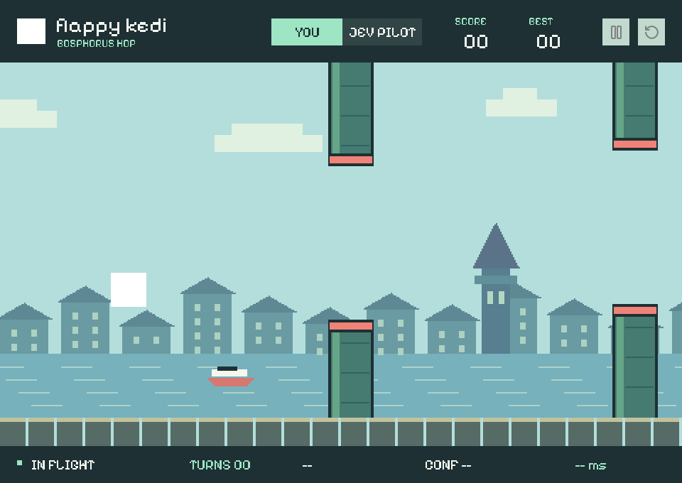

# Flappy Kedi

A pixel cat, a Bosphorus skyline, and two possible movements: **flap** or
**coast**. Play yourself, or let a Kedi program ask Jev or local Laya for each decision.



This is a small working game, not a model benchmark. Python handles graphics
and physics; Kedi owns the pilot's typed decision and its repeated interaction
with the game. The model cannot execute code or modify the simulation.

## Run

From the repository root, using the checkout's environment. Clone the separate
decision-model monorepo first if `decisions/` does not already exist:

```bash
source .venv/bin/activate
git clone https://github.com/kedi-lang/kedi-decisions.git decisions
uv pip install -e decisions -e decisions/packages/kedi-typesafe
uv pip install -e 'examples/flappy_kedi[jev]'
kedi examples/flappy_kedi/main.kedi
```

The editable install makes the local Python engine importable and installs
Pygame, Pymunk, and shared decision criteria. The `jev` extra adds TypeSafe;
Laya-only and manual installations do not need it. It does not publish a package or
replace the Kedi checkout. **The entrypoint is `main.kedi`, not a Python script.**

Put `TYPESAFE_API_KEY` in the checkout's `.env` or the environment. The Kedi CLI
loads the environment; the pilot inherits it. Jev uses `jev-latest`
through `kedi-typesafe`; the example does not require another model provider.
The pilot starts only when you press **Take off**. The default limit is 80
decisions per round. Restarting starts a new round with a new decision budget.

For manual play, no API key or model call is needed (use the same installation):

```bash
kedi examples/flappy_kedi/main.kedi --pilot manual
```

Click the scene or press **Space** to jump in manual mode. **P** pauses,
**R** restarts, and **Esc** closes the window. The top controls switch pilots,
pause, and restart. The window can be resized without changing the physics.
On Windows, activate `.venv\Scripts\Activate.ps1` instead of using `source`.

## What Kedi does

### Local Laya pilot

Install the separate local Laya integration; it is not part of `kedi-typesafe`:

```bash
uv pip install -e decisions -e 'decisions/packages/kedi-laya[mlx,pydantic]'
uv pip install -e examples/flappy_kedi
kedi examples/flappy_kedi/main.kedi --pilot laya
```

This uses `aac6fef/laya-multilingual-mlx` on Apple Silicon, with no API key.
The first run downloads roughly 678 MB. To use a checkpoint already on disk:

```bash
kedi examples/flappy_kedi/main.kedi --pilot laya \
  --model laya/tmp/laya-multilingual-mlx
```

`laya/<checkpoint>` selects MLX when installed on Apple Silicon, otherwise
PyTorch. Use `[torch,pydantic]` with a compatible checkpoint on other hosts;
`laya-mlx/<checkpoint>` still forces MLX. The Kedi pilot,
physics, observation, and 60% acceptance rule stay unchanged. Laya and Jev
confidence are calculated differently: the same cutoff is not a matched
calibration. A model startup/validation error is an error, not a game loss.
Weights stay resident for the round. Restart creates a fresh pilot process.

### Decision program

[main.kedi](main.kedi) imports the Python engine and opens the game itself.
[pilot.kedi](pilot.kedi) contains the decision program, importing the shared
`ChoiceCriteria` from `kedi_decisions` because the same program supports both
providers. Provider-specific programs can use `> import: typesafe` or
`> import: laya` instead.
The `Movement` type names the two legal actions and describes when each is
appropriate. `@decide` puts the current observation into a natural-language
template and captures that finite choice. Its typed `Decision` includes the
selected action, `decision_info("movement").confidence`, and whether the decision
meets the **0.60 minimum confidence**. This rule lives in Kedi, not in a hidden
Python controller.

`@play` repeatedly receives an observation, calls `decide`, and sends the
result back. A `None` observation ends the loop. The Python pilot
binds `pilot.kedi` with the public `@kedi.bind(file=...)` API and supplies
`PydanticAdapter(TypeSafeModel(...))` through `kedi.context`.

| File | Responsibility |
| --- | --- |
| [main.kedi](main.kedi) | Entrypoint: import the engine and launch it with the Kedi pilot program |
| [pilot.kedi](pilot.kedi) | Choice criteria, typed capture, decision metadata, pilot loop |
| [flappy_kedi/app.py](flappy_kedi/app.py) | Imported host: input, round state, pause/restart, recording |
| [flappy_kedi/pilot.py](flappy_kedi/pilot.py) | Isolated pilot process and bounded request channel |
| [flappy_kedi/world.py](flappy_kedi/world.py) | Seeded course and fixed-step Pymunk physics |
| [flappy_kedi/view.py](flappy_kedi/view.py) | Original pixel sprites, skyline, controls, responsive canvas |

## Timing and information boundaries

- Jev receives the cat's height and vertical speed, the next opening, and two
  approximate short trajectory forecasts computed from the public physics.
  This is state-based decision making, **not vision-based play**. A deterministic
  controller could also play this game; no advantage over one is claimed.
- A choice is accepted only when its confidence is at least **60%**. Lower or
  missing confidence means no flap: gravity continues to act. The UI shows
  `LOW CONFIDENCE`; traces distinguish the model's `action`, `accepted`, and
  `applied_action`. There is no extra request to retry an uncertain choice.
  Invalid answers or provider failures stop the round with an error.
- Physics pauses while the model responds, then advances 28 fixed steps at
  120 Hz per decision. Network latency therefore affects wall time, not falling
  distance. This is **not a real-time reaction-speed test**.
- The main process continues processing window events while the pilot waits.
  A round has at most one outstanding decision. Pause holds the current state;
  a response already in flight can finish, but is not applied until resumed.
- Restart/close stops the old worker before starting another. A 25-second host
  deadline bounds each outstanding decision, including initial worker startup;
  the model client's request timeout is 12 seconds. SDK retries may mean more
  provider requests than the displayed number of decisions.
- Confidence is the provider's evidence for the selected choice, not a
  calibrated probability of surviving the next obstacle. Refusing an uncertain
  flap can itself cause a collision; the threshold is an explicit policy,
  not a guarantee of better play.

## Record a bounded flight

```bash
kedi examples/flappy_kedi/main.kedi --headless --seed 7 --max-decisions 80 \
  --trace /tmp/flappy-kedi.jsonl --screenshot /tmp/flappy-kedi.png
```

Headless mode uses SDL's dummy display. It preserves the same physics and pilot
but advances simulation batches faster between decisions. The output JSONL is
append-only and contains public observations, actions, confidence, latency,
and round outcomes, never API credentials. Use a fresh filename to isolate a
run. Screenshots are optional; parent directories must already exist.

`complete` means the configured decision limit was reached while still alive,
not that an endless game was won. `over` means collision; `error` means a pilot
or credential problem, not a scored loss. `stopped` means the user or frame
limit interrupted a running round. Provider errors propagate as Kedi runtime
errors; the CLI exits unsuccessfully instead of reporting a completed flight.

## Verification

Before the 60% confidence gate was added, on September 30, 2026, one live Jev
flight on seed 7 reached **80 decisions and 5 gates**, surviving **18.667
simulated seconds** in **31.077 wall seconds**.
A preceding 24-decision check also completed and passed one gate. These are
individual smoke checks, not an accuracy or latency estimate. Neither result
is replayed by the application. Model outputs and network latency can vary.

The final Kedi CLI entrypoint was also tested live: without the confidence gate,
it reached the same 80-decision limit and five gates in 30.150 seconds.
The median end-to-end decision latency was **309 ms**, including Kedi, transport,
and provider work; this does not isolate model inference time. Desktop mode
additionally plays each 0.233-second simulation batch at its normal speed.

With the requested **60% gate**, a subsequent live flight ended in collision
after **15 decisions**, with **0 gates** and **3.333 simulated seconds**.
Four choices were accepted; eight proposed flaps were rejected for low
confidence. **No below-threshold flap was applied.** This validates the policy,
not a claim that the policy improves survival. The earlier five-gate result
must not be attributed to the new thresholded pilot.

The regression tests exercise physics, the actual Kedi loop with a controlled
model, lifecycle controls, and rendering without paid requests:

```bash
python -m pytest tests/test_flappy_kedi.py tests/test_curated_examples.py --record-mode=none
```

The game tests skip when its optional graphics dependencies are not installed.

## Assets and libraries

The cat and Istanbul scenery are original, code-defined pixel art. The bundled
[Pixelify Sans font](https://github.com/google/fonts/tree/main/ofl/pixelifysans)
uses the [SIL Open Font License](flappy_kedi/assets/OFL.txt).
[Lucide](https://github.com/lucide-icons/lucide) supplies the control icons;
its license is included in [LUCIDE_LICENSE](flappy_kedi/assets/LUCIDE_LICENSE).

[Pygame](https://www.pygame.org/docs/ref/event.html) owns the display/event loop;
[Pymunk](https://www.pymunk.org/en/latest/pymunk.html) supplies collision detection
and rigid-body integration. No browser, GPU model runtime, or background service
is required.
